# Playtest 1 — Quiet Is Safer, v154

Grałam jako Hania (forma „ona”), w oknie 390×844, z user-agentem iPhone’a, po polsku. Wersja z gałęzi `feat/realizm-2026`, commit `16888b0`, cache service workera `quiet-is-safer-v154`. Serwer: `node serve.js` na porcie 5173.

Wygląd, kampania i zdjęcia są wyłącznie z tej gałęzi. `main` i starsze gałęzie pominęłam. Gałąź `wip/v155-nieprzetestowane` tylko obejrzałam w handoffie i jej nie uruchamiałam.

Doszłam organicznie przez cały prolog „Nieodebrane” i początek rozdziału 1: odzyskanie Nimbusa (Kluska / Kometa, hasło, menu telefonu Mai), galerię i oś czasu z 14 października. Strachy z późniejszych rozdziałów odpaliłam ręcznie w normalnym tempie, bo do nich fabuła jeszcze mnie nie doprowadziła. Kodu gry nie zmieniałam.

Pulpit po odblokowaniu jest dobry. Dwie strony, kropki, dock, pogoda, ikony. Tego ekranu nie ruszamy.

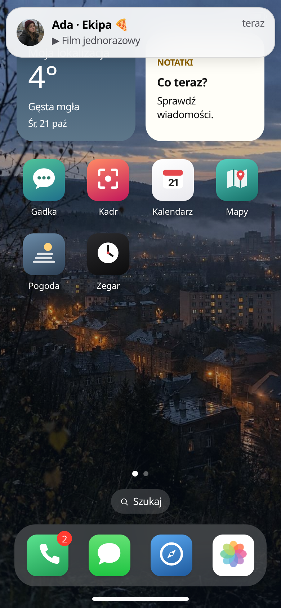

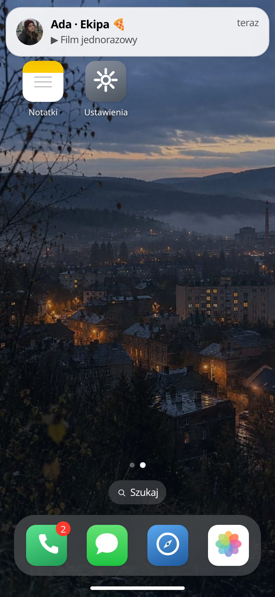

## Werdykt

Haczyk jest. Film od Ady, a potem informacja, że ten numer był Adama Rybickiego, trzyma. Strachu na razie nie ma, bo wszystko, co ma być głosem albo zdjęciem z telefonu, jest nieme albo wygląda jak materiał z generatora. Środek prologu to chodzenie z dowodem z powrotem do Kuby. Nimbus w rozdziale 1 jest pierwszą chwilą, w której telefon naprawdę jest dowodem.

## 1. Haczyk i nuda

Ekran tytułowy mówi wprost, o czym to jest, i ma ostrzeżenie (zaginięcie, śmierć dziecka, przemoc). To jest w porządku, gram świadomie.

Potem blokada. Na niej już wisi powiadomienie od Ady z Ekipy: „widzieliście to?”. Chcę odblokować.

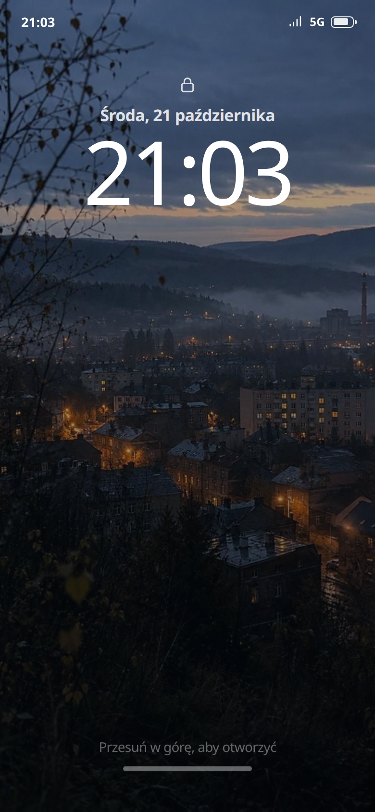

Film jednorazowy w Gadce jest najlepszym otwarciem tej sesji. Ada wrzuca kafel, Szymon mówi, żeby nie puszczać takich rzeczy na noc, ja mam wybrać, czy puszczam dalej. Zagrałam: „Ktoś nagrał jej relację i puścił dalej. To nie jest dla nas.”

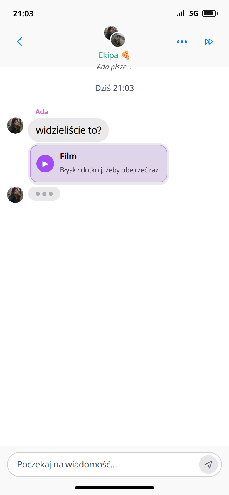

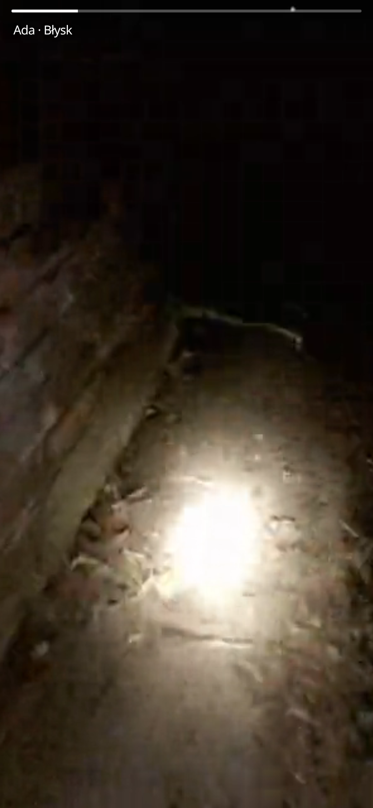

Potem tempo siada. Kuba pisze serią, ja odpowiadam, a kolejne cele to: otwórz Telefon, otwórz SMS, pokaż Kubie, wyszukaj Tomka, pokaż artykuł, wyszukaj Rybickiego, pokaż nekrolog. Każdy krok jest logiczny. Razem czują się jak lista zadań, nie jak noc, w której boję się odłożyć telefon.

Moment, w którym znowu się pochylam: artykuł ma w stopce mój numer, a gra puszcza bicie serca. To jest nagroda za grzebanie. Tego trzeba więcej, czekania na „pisze…” mniej.

W normalnym tempie opcje w Ekipie przyszły jakieś 20 sekund po filmie. Da się wytrzymać raz. Przy trzecim takim czekaniu w prologu już scrolluję z nudów.

## 2. Czy jest strasznie i czy zdjęcia wyglądają na zrobione

Na tym odcinku nie jest strasznie. Jest niepokojąco w tekście (numer nieboszczyka, dziewczyna dzwoniła do mnie o 23:47 i zniknęła). Obraz i dźwięk tego nie dociągają.

Film od Ady (`assets/video/v_snap.mp4`) odpalił się, trwał ok. 8 sekund i był wyciszony w samym odtwarzaczu. Plik nie ma ścieżki audio. Plakat (`assets/video/v_snap.jpg`) wygląda jak nocna sesja: równa twarz, las, lampa telefonu. W fabule to ma być nagranie ekranu relacji z Kadru, drżąca ręka, kufajka na słupku. Tego wrażenia nie ma. Handoff i tak ma tu otwarty punkt: nowy klip found-footage jest zablokowany brakiem kredytów. Z perspektywy gracza to jest właśnie ta dziura.

Zdjęcie, które Kuba podpisuje jako Maję znad Mglicy, idzie z `assets/maja-river.jpg` (`Art.url` dla `k_maja`). To gładki portret dziewczyny z telefonem przy wodzie. Brat w 2026 wysłałby krzywe zdjęcie z rolki, z palcem w kadrze albo ze złą pogodą. Tu skóra i światło są zbyt równe. W `js/art/scenes.js` nadal leży rysunkowy fallback (zachód, ludzik, prostokąt aparatu). Na ekranie widzę jpg, i on też nie przechodzi jako zdjęcie z telefonu.

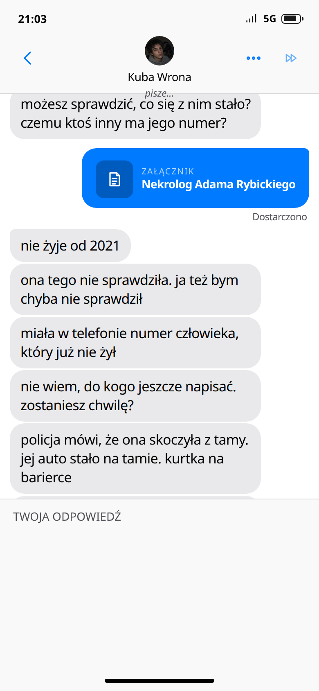

MMS od Szklarza (`assets/web/sz_window.jpg`) to nocne okno, sylwetka i wbitty w szkło napis „kazde szklo ma dwie strony”, bez polskich znaków. Napis na zdjęciu zdradza, że to plansza, a nie fotka puszczona z nieznanego numeru. Pełny ekran jest w `playtest/58-sz-window-pelne.png`.

Awatary (Maja, Ada, reszta) są fotograficzne i na ikonkę wystarczą. Jako twarz, która ma mnie wystraszyć w połączeniu, Maja wygląda jak zdjęcie profilowe, nie jak ktoś, kto właśnie dzwoni z ciemności.

## 3. Czat kontra aplikacje

Prolog używa telefonu, nie tylko dymków. Po kolei: blokada, Gadka, film Błysku, SMS od Kuby, aplikacja Telefon (nieodebrane z 13.10 i 14.10), wątek SMS z numeru `+48 731 402 118`, Szukajka (Tomek Lis, Adam Rybicki), karty dowodów. To jest dobry szkielet.

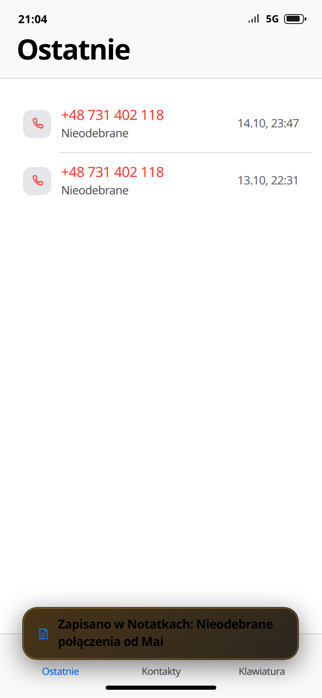

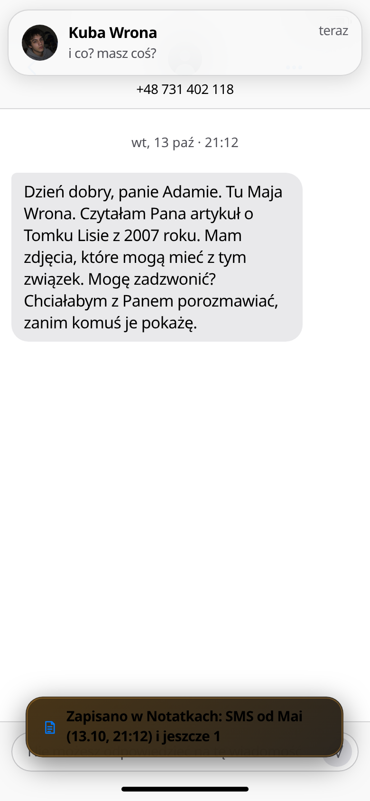

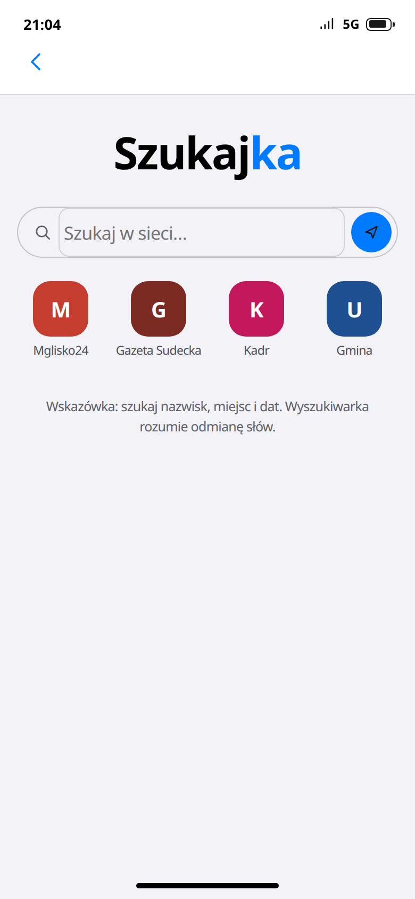

Słaby jest środek: prawie każdy wynik kończy się „wróć do Kuby i pokaż”. Aplikacja jest korytarzem, rozmowa jest pokojem, w którym siedzę za długo.

Rozdział 1 to odwraca. Nimbus jest kontem Mai. Pytania bezpieczeństwa da się znaleźć na jej Kadrze (post o Klusce, 2006–2019, i post o Komecie-E od dziadka). Po zalogowaniu widzę telefon Tellio A54, offline, ostatnia kopia 14.10.2026, 23:58. Galeria ma Aparat, Fotopułapki, Negatywy, Zrzuty. Lokalizacja z 14 października jest konkretna: dom, stacja „Mglica”, znowu dom, o 22:58–23:58 Huta Szkła „Jutrzenka”, ostatni sygnał 23:58, dokładność 12 m. To jest pierwsza scena, w której chcę klikać dalej sama, bez prowadzenia za rękę.

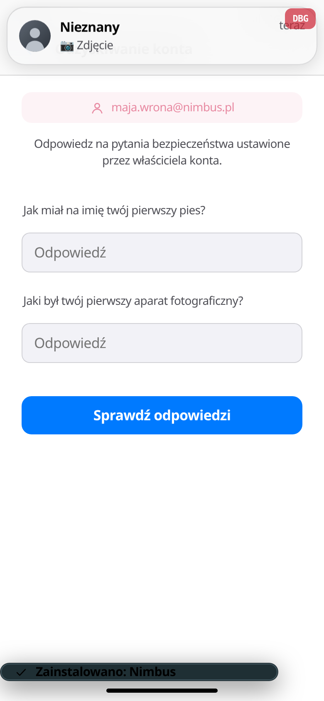

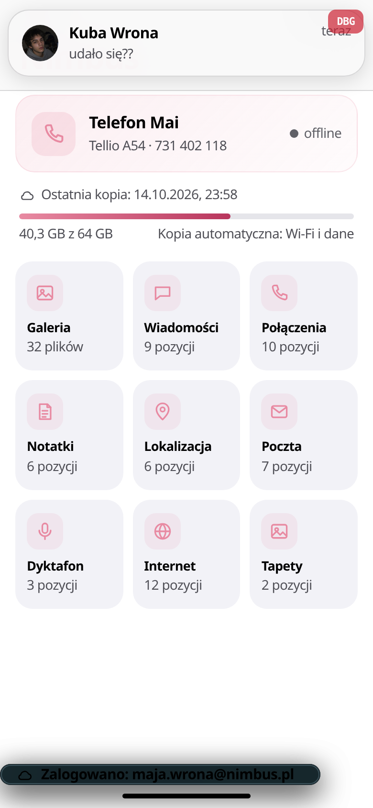

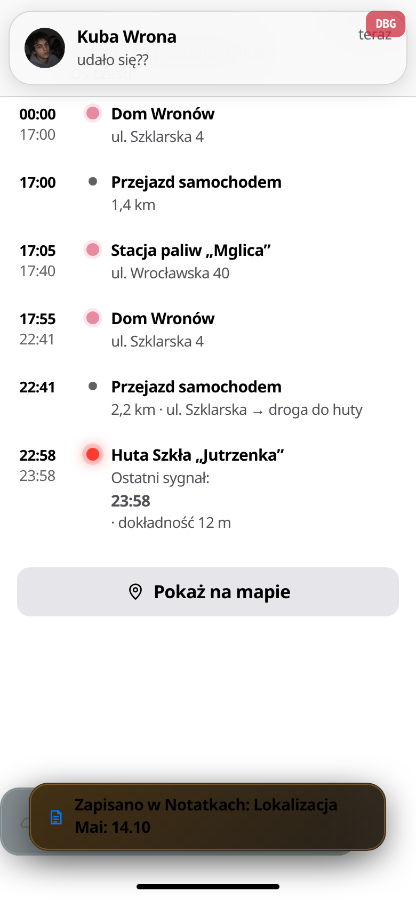

## 4. Jak mówią ludzie

Kuba, kiedy jest zmęczony i konkretny, brzmi jak dziewiętnastolatek:

- „racja, bez sensu zacząłem. jeszcze raz”
- „kuba jestem. jej brat”
- „potem już do nikogo nie dzwoniła. przynajmniej w tym bilingu nic więcej nie ma”
- „wpisałem bandzior i lustrzanka. nic” i zaraz „a potem do mnie dotarło, że wpisałem psa, którego mamy teraz”

Szymon też jest wiarygodny: „ada, nie wrzucaj takich rzeczy na noc”, „idę spać. wy też idźcie”.

Ola na grupie brzmi jak osoba, nie jak quest: „Kuba, serio? Nawet nie napisałeś, że kogoś dodajesz.”

Słabsze:

Ada, wiadomość o filmie: „krąży po całym błysku. ktoś nagrał ekranem relację z kadru tej dziewczyny, co zaginęła tydzień temu w jakimś mglisku.” Nazwy aplikacji w środku zdania słychać jako interfejs. Propozycja: „ktoś nagrał ekranem jej ostatnią relację. tę dziewczynę z Mgliska, co zaginęła tydzień temu. podobno to było ostatnie, co wrzuciła. było w wiadomościach.”

Kuba na grupie, przy mnie: „dodałem Hania. to ta osoba, do której maja dzwoniła ostatnia.” Imię w mianowniku. Propozycja: „dodałem Hanię. maja dzwoniła do niej jako ostatnia.” Przy formie „on” analogicznie „dodałem Hanię” nie wystarczy — potrzebna odmiana albo „dodałem osobę, do której maja dzwoniła”.

Szklarz: „nie odebralas wtedy”, „masz jeszcze te wiadomosc od niej?”, „tym razem odbierz”. Brak ogonków jest wpisany w postać (`plainTyper` dla szklarza, natana, bartka i zuzy). Zostawić. Krótkie linie działają lepiej niż dłuższy monolog.

Igor: „spokojnie. technicznie rzecz biorąc, nimbus blokuje dopiero po dziesięciu próbach.” To jest trop do anonima, nie dziwna kwestia. Zostawić.

SMS Mai do „pana Adama” jest celowo formalny i taki ma być. „Dzień dobry, panie Adamie. Tu Maja Wrona. Czytałam Pana artykuł o Tomku Lisie z 2007 roku.”

## 5. Nazwy

Działają: Wiadomości, Telefon, Notatki, Mapy, Pogoda, Kalendarz, Zegar, Ustawienia, Nimbus (brzmi jak chmura, nie jak żart), Kadr (jak rolka zdjęć), Ciemnia.

Słabo słychać w ustach dwudziestolatki:

| Jest | Czemu zgrzyta | Bliżej 2026 |
| --- | --- | --- |
| Gadka | zdrobnienie, jak aplikacja dla dzieci | Zostaw ikonę i morski kolor, nazwa może być krótka i obca, np. „Fala” albo po prostu nic nie mówić w dialogu i pisać „na grupie” |
| Szukajka | to samo zdrobnienie; na iPhonie i tak podpisujesz to Safari | W dialogu mów „wyszukaj”, nazwę aplikacji zostaw systemową |
| Klipo | brzmi jak suplement albo sok | „Rolka” albo zostaw bez nazwy w kwestiach, skoro to DM wideo |
| Błysk | da się obronić (snap = błysk), ale Ada mówi „po całym błysku” i wychodzi sztucznie | W UI może zostać. W kwestiach: „puścił to dalej” |
| BushView | angielski na polskim telefonie, obok Ciemni i Nimbusa | „Podgląd” albo nazwa, która brzmi jak tania aplikacja z lasu, po polsku |

Postacie: Kuba Wrona, Ola Nowicka, Bartek Sowa, Igor Malicki, Szymon Bielak — normalne. Ada Kurek gra ze mną w Ekipie, a w sprawie mostu jest Janina Kurek i firma Kurek-Bud. Jeśli Ada nie jest z tej rodziny, nazwisko trzeba zmienić, bo w takim miasteczku od razu łączę kropki. Jeśli jest, prolog powinien tego nie tłumaczyć, ale ktoś z ekipy może kiedyś powiedzieć „twoja Ada? ta od Kurków?” — inaczej wygląda to na przypadek.

Tytuł na tym buildzie to QUIET IS SAFER. MGLISKO zostaje w mieście, w pogodzie od pewnego momentu i na kurtynach końcowych. Miasto niech zostanie Mgliskiem. Nazwy aplikacji niech nie brzmią, jakby ktoś je wymyślał na głos.

## 6. Spójność fabuły

Trzyma się:

- Numer dostałam po kimś. Maja 13.10 o 21:12 pisze do pana Adama o Tomku Lisie. Nieodebrane: 13.10, 22:31 i 14.10, 23:47.
- Adam Rybicki nie żyje. Artykuł z 2007 jest jego. Bicie serca przy „to jest twój numer” jest uczciwe wobec tego, co właśnie przeczytałam.
- Kuba myli obecnego psa (Bandzior) z pierwszym (Kluska). Na Kadrze jest sprostowanie. Dobre.
- Kopia urywa się 14.10 o 23:58 w hucie. Kuba w prologu mówi, że policja stawia Maję koło północy na tamie, a telefon łapał sieć o 23:58. Oś czasu w Nimbusie pokazuje hutę, nie tamę. To jest haczyk na dalej i na tym odcinku się zgadza.
- „Technicznie rzecz biorąc” u Igora jest tym samym zwrotem, który później ma pasować do Szklarza.

Rozjeżdża się albo gaśnie:

- Karta na liście Wiadomości od pierwszej sekundy prologu: „ZAGINIONA / 14 PAŹDZIERNIKA”, „Maja Wrona”, „Ostatnie połączenie było do ciebie.” Wątek niżej nadal nazywa się `+48 731 402 118`. Wiem, jak ma na imię i że zniknęła, zanim Kuba zdąży to powiedzieć. `chat:maja` odblokowuje się w pierwszym kroku prologu, a karta jest rysowana dla każdego odblokowanego wątku Mai (`js/apps/messages.js`, lista rozmów).
- Cel „Sprawdź, co stało się z Adamem Rybickim” wisi w „Co teraz?” jeszcze przy ostatnim wyborze prologu, kiedy nekrolog już Kubie pokazałam (`playtest/56-cel-wiszacy.png`). Po zalogowaniu do Nimbusa widget dalej mówi „Odzyskaj dostęp do konta Nimbus Mai”, a toast już powiedział „Zalogowano”.
- Film-relacja nie wygląda jak relacja (punkt 2). Wyjaśnienie w rozdziale 3 (brama, kufajka, 14.10, 22:56) na razie nie ma czego tłumaczyć, bo obraz tego nie przypomina.
- Do rozdziału 3, długości ~22 min z handoffu, nie doszłam. Z prologu widać ten sam typ przeciągnięcia: dużo eskorty, mało nowego faktu na minutę.

## 7. Bugi techniczne

### Dymki

Nie złapałam nieskończonego „świrowania” w górę i w dół. Przy serii dziesięciu wiadomości scroll szedł tylko w dół. Potwierdzenie dostarczenia zostawało 3 px pod dymkiem w trakcie animacji.

To, co na telefonie czuć jako skakanie, jest w kodzie:

- Każdy przychodzący dymel ma `.msg.in`: `msgin` 0,32 s, `cubic-bezier(.2, 1.1, .3, 1)`. Jedynka z hakiem daje overshoot, dymel wyjeżdża wyżej i wraca (`css/apps.css`).
- `scrollEnd` woła `scrollTo({ behavior: 'smooth' })` przy wiadomości i przy wskaźniku pisania (`js/apps/messages.js`). Nowa wiadomość restartuje płynny scroll poprzedniej.
- Wiersz „pisze…” jest zdejmowany i wstawiany od nowa, więc lista jeszcze raz się układa.

Stary crash z v142 (lista czyszczona, a odpięty wiersz pisania zostawał i `insertBefore` wywalał Ekipę) ma już test `tests/rerender-typing.browser.cjs`. Tego wywalenia w tej sesji nie było.

Propozycja, kiedy przyjdzie pora na kod: wejście dymka bez przekraczania pozycji (bezier kończący się w 1, bez 1.1) i jeden scroll na serię, nie na każdą ramkę pisania. Wyglądu dymków i pulpitu nie zmieniać.

### Odblokowanie

Podpowiedź to „Przesuń w górę, aby otworzyć”. Tap w ten napis otwiera telefon. Gest liczy się dopiero przy ruchu w górę o więcej niż 60 px (`js/core/ui.js`, `pointerup`). Krótsze pociągnięcie, ok. 45 px, nie robi nic i ekran o tym nie mówi. Blokada nie jedzie za palcem. Po sukcesie dopiero dostaje klasę ze zjazdem. Napis ma nieskończoną animację `breathe` (2,4 s, `translateY(-3px)`), więc sam hint cały czas lekko skacze.

Na prawdziwym telefonie ludzie robią krótki flick. Tu trzeba świadomie przeciągnąć albo trafić w tekst. Długie przytrzymanie tapety (650 ms) otwiera wybór tapety i przy ruchu powyżej 10 px puszcza — to jest w porządku i nie blokuje swipe’a, o ile swipe jest dość długi.

### Personalizacja

Na starcie jest imię (maks. 20 znaków) i „on” / „ona”. To wystarcza, żeby Kuba napisał „gadałaś”.

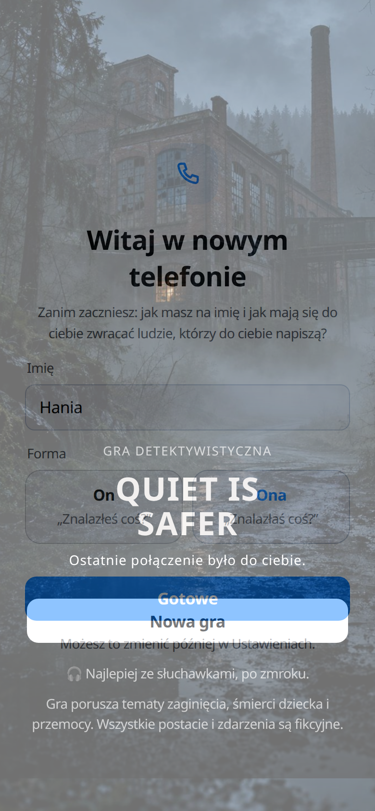

W Ustawieniach da się później zmienić: iOS / Android / auto, jasny-ciemny, rozmiar tekstu, tapetę, tempo wiadomości, dźwięki, wibracje, łagodniejsze straszenie, podpowiedzi, imię i formę. Awatara ani statusu nie ma. Własnego numeru się nie wybiera — i dobrze, bo numer jest fabułą.

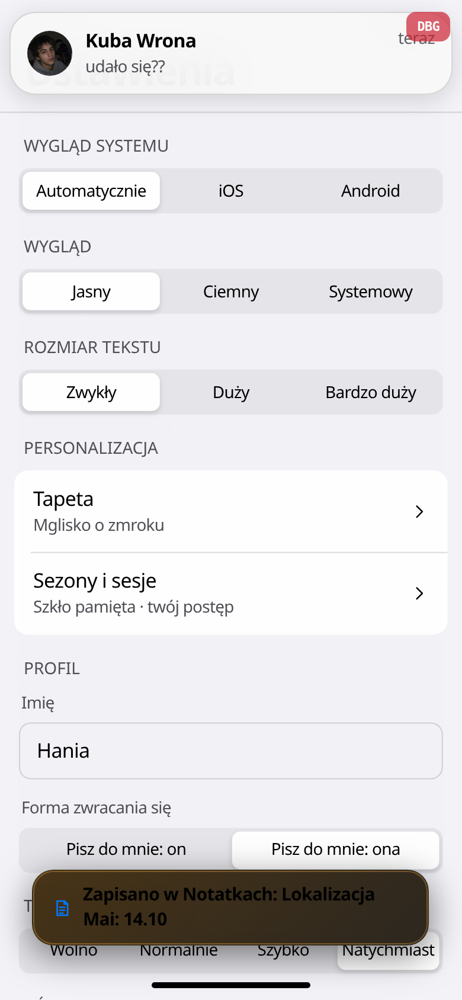

### Wideo na tym serwerze

`serve.js` nie ma w mapie MIME typu dla `.mp4`. Plik idzie jako `application/octet-stream`. Chrome ten klip puścił. Safari na iPhonie często takiego typu nie odtwarza w `<video>`. Handoff i tak każe sprawdzić grę na prawdziwym telefonie. To jest pierwszy kandydat, czemu film na iPhonie miałby być czarnym kaflem.

### Drobne

- Po wejściu w Nimbus formularz logowania zostaje pod spodem odzyskiwania. Gracz tego nie klika, jeśli trafia w pole na wierzchu. Dla gracza niewidoczne. Wspominam, bo dwa pola „E-mail” są naraz w drzewie.
- Pogoda na początku mówi „Moja lokalizacja”. Przy Nimbusie jest już „Mglisko”. Tak ma być: miasto poznaję w trakcie.

## 8. Jumpscare i głos w połączeniach

W prologu, tuż przed Szklarzem, jest `fx('glitch')`. W kodzie ten efekt to wibracja i krótka pauza. Interfejsu nie psuje. Dobrze, że nieznany numer nie przejmuje mi telefonu w pierwszej minucie. Jako strach jest za cicho, dosłownie.

Prawdziwe strachy są wpięte w fabułę, nie w losowy timer. Nie doszłam do nich grą. Odtworzyłam te, które dotyczą otwarcia, funkcją `UI.scare` w tempie normalnym:

- Glitch (`ch2`, `s1_odsluch`, przy głosówce z szumem i trzaskiem szkła): klasa `scare-glitch` na ekranie, ok. 0,56 s, plus szum z syntezatora. Krótki. Bez obrazu.
- Połączenie od Mai (`ch3`, `s1_maja_numer`, numer `+48 731 402 118`): dzwonek jest syntetyczny. Po odebraniu zostaje awatar, licznik `00:00` i oddech złożony z szumu (dwa `burst` w `js/core/audio.js`). Elementu `<video>` nie ma. Elementu `<audio>` nie ma. Mowy nie ma. Komentarz w `ui.js` mówi wprost: odebranie to cisza i oddech.

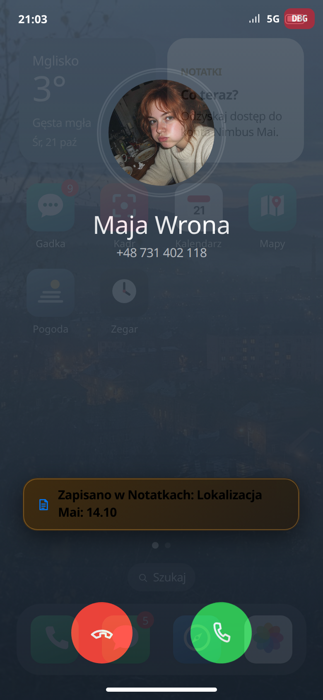

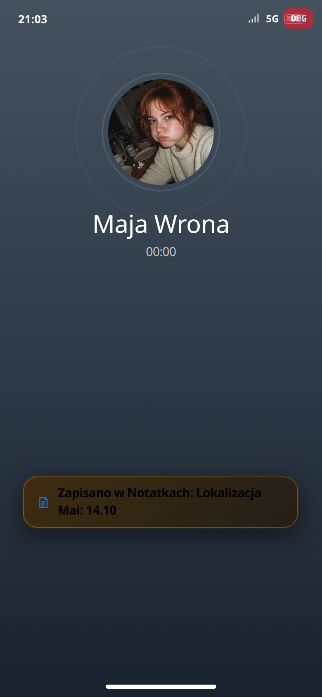

- Twarz / zbliżenie (`ch5`, `s1_hand`, u mnie na pliku `sz_window`, bo to zdjęcie z prologu): pełny ekran, klasa `zoom`, podpis, ok. 1,3 s, plus „sting”. Mechanicznie działa. Obrazek jest tą samą planszą z napisem na szybie, więc zbliżenie nie straszy.

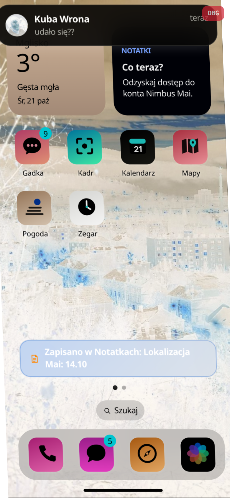

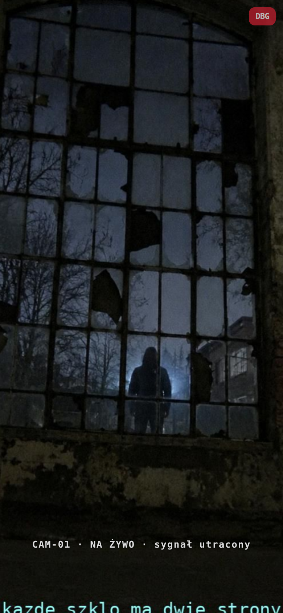

Głosówki w czacie (`voice:czas|kto|transkrypcja`) nie mają pliku. Przycisk ma etykietę „Pokaż transkrypcję wiadomości głosowej” i tylko odkrywa tekst. W rozdziale 2 Igor i Ola reagują na głosówkę, jakby coś było słychać (szum, zegar, trzask szkła). Gracz czyta opis dźwięku.

Z wszystkich `assets/video/*.mp4` ścieżkę `soun` ma tylko `v_anonim.mp4`. I tak ląduje w `<video muted>`. Czyli nawet ten jeden plik z dźwiękiem jest puszczany bez głosu.

Odpowiedź na pytanie „czy w wideo z połączeń jest głos”: połączenie nie jest wideo. Głosu mówionego nie ma nigdzie w tym, co przeszłam. Jest dzwonek, szum i oddech z generatora.

## Lista problemów

### P0

1. **Nie ma głosu tam, gdzie gra obiecuje głos.** Film Błysku jest wyciszony w kodzie i nie ma ścieżki audio. Połączenie-strach to awatar i syntetyczny oddech, bez wideo i bez mowy. Głosówka to waveform i transkrypcja. Jedyny plik ze ścieżką, `v_anonim.mp4`, i tak idzie jako `muted`. Bez tego rozdział 2 („szum, zegar, trzask szkła”) i połączenie od Mai zostaną opisem horroru.
2. **Pierwsze obrazy nie wyglądają jak zdjęcia i nagrania z telefonu.** Plakat i klip snapa są zbyt gładkie jak na nagranie ekranu relacji. `k_maja` to `assets/maja-river.jpg`, portret studyjny, nie fotka brata z sierpnia. `sz_window` ma wbitą sentencję bez ogonków. To jest ten sam otwarty punkt co w handoffie (realizm zdjęć, nowy klip). Dopóki tak wyglądają, zbliżenie i MMS nie straszą.

### P1

3. **Lista SMS spoileruje sprawę od pierwszej sekundy.** Karta „ZAGINIONA / 14 PAŹDZIERNIKA / Maja Wrona” jest widoczna, kiedy cel nadal każe szukać numeru `+48 731 402 118`. Karta powinna pokazywać numer, dopóki gracz nie pozna nazwiska od Kuby albo z treści SMS-a.
4. **„Co teraz?” nie gaśnie po zrobieniu rzeczy.** Cel o Rybickim wisi do końca prologu. Cel o Nimbusie wisi po zalogowaniu. `goal()` i `waitFor` są osobnymi krokami, a silnik czyści cel tylko wtedy, gdy krok `wait` sam niesie `st.goal` równy tekstowi celu (`js/core/engine.js`). Oba te waitów tego pola nie mają.
5. **Swipe z blokady nie zachowuje się jak swipe.** Próg 60 px, brak jazdy za palcem, krótkie pociągnięcie jest martwe, napis wiecznie podskakuje. Tap w napis działa. Zostaw wygląd pulpitu. Rusz tylko gest.
6. **Dymki podskakują na wejściu.** Overshoot w `msgin` plus `behavior: 'smooth'` na każdą wiadomość i na każde przebudowanie „pisze…”. Ciągłego jo-jo nie zmierzyłam. Wyglądu bąbelków nie przerabiać, tylko krzywej i scrolla.
7. **Środek prologu jest eskortą.** Telefon, SMS, Szukajka i dowody są podpięte dobrze. Pętla „przynieś to Kubie” powtarza się trzy razy, zanim Nimbus odda mi telefon Mai. Film i „to twój numer” nieść prolog. Resztę ścieśnić.
8. **„dodałem Hania”.** Imię w mianowniku na grupie. Odmienić albo przebudować zdanie tak, żeby działało dla dowolnego imienia i obu form.

### P2

9. **Personalizacja na starcie to imię i forma.** Reszta jest w Ustawieniach i tam jest jej dość (system, motyw, tekst, tapeta, łagodne strachy). Awatara nie brakuje do tej historii. Własny numer ma zostać numerem Rybickiego. Pulpitu nie ruszać.
10. **Gadka, Szukajka, Klipo, BushView** brzmią obok reszty telefonu jak inne gry. W kwestiach mówić po ludzku („na grupie”, „wyszukaj”). Nazwy w UI można zmienić później, bez ruszania układu ikon.
11. **Ada Kurek i Kurek-Bud.** Albo to jedna rodzina i warto to kiedyś powiedzieć wprost w sprawie mostu, albo Ada dostaje inne nazwisko, zanim gracz sam to połączy.
12. **`serve.js` serwuje mp4 jako `application/octet-stream`.** Na tym Chrome film poszedł. Na iPhonie to pierwszy podejrzany, zgodnie z punktem handoffu o teście na prawdziwym telefonie.
13. Brak ogonków u Szklarza, Bartka, Natana i Zuzy jest celowy. Nie naprawiać.

## Czego nie ruszać

- Pulpit po odblokowaniu: dwie strony, swipe, dock, pogoda, zestaw ikon.
- Formalny SMS Mai do pana Adama.
- Kuba w trybie „nie spałem, biling, bandzior to zły pies”.
- Trop „technicznie rzecz biorąc”.
- Ostrzeżenie na tytule.
- Oś czasu 14 października w Nimbusie. To jest wzór, jak aplikacja ma opowiadać.

## Handoff, którego nie robiłam

Z `docs/HANDOFF-AGENT.md` (25.10.2026, 14:45): v155 nietestowane, spójność S1–S5, skrócenie rozdziału 3, nowy klip snapa, realizm zdjęć, test na iPhonie, wdrożenie dalej jest v147. Ten plik jest tym brakującym przejściem człowieka po v154. Nic z tamtej listy nie wdrożyłam i v155 nie scalałam.
